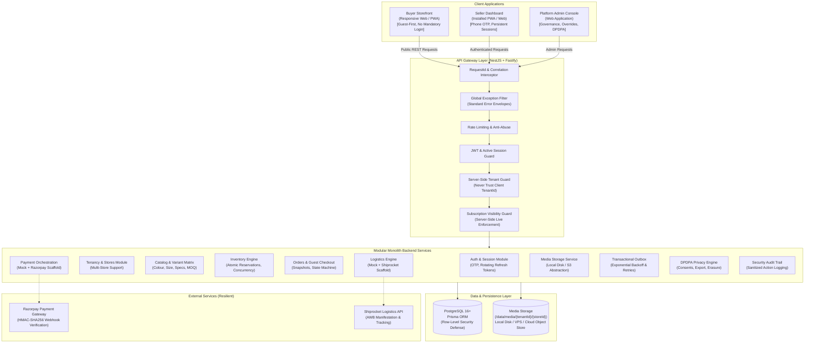
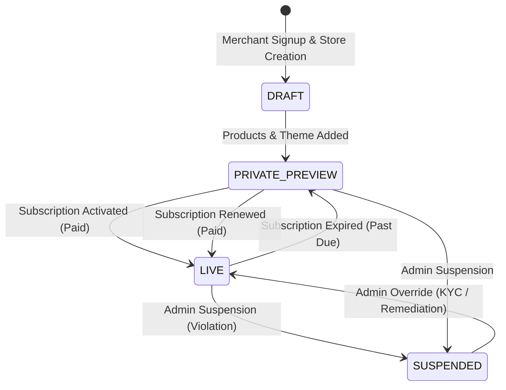
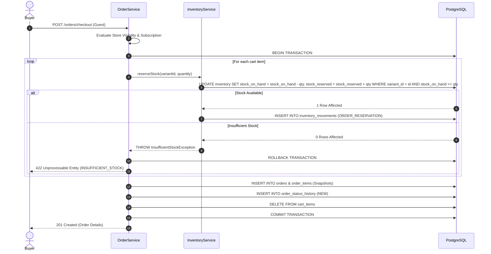

# Simply E-Commerce - Platform Architecture

## 1. Executive Summary & Vision

**Simply E-Commerce** (working name, brand name configurable via `BRAND_NAME`) is an enterprise-grade multi-tenant Software-as-a-Service (SaaS) ecommerce platform engineered specifically for Indian businesses, merchants, manufacturers, and direct-to-consumer (D2C) brands.

The platform is designed around four foundational pillars:
1. **Speed & Simplicity**: Lightning-fast page loads, minimal buyer checkout friction with zero mandatory buyer login.
2. **Robust Multi-Tenancy**: Ironclad tenant isolation across database queries, application guards, and PostgreSQL row-level security.
3. **Commercial Discipline**: Server-side subscription-gated store visibility. Unpaid merchants can build, configure, and privately preview their store inside the Seller PWA, but the public storefront and checkout remain completely inaccessible until an active paid subscription is verified.
4. **Resilience & Privacy**: Fail-safe integration architecture for Indian third-party services (Razorpay, Shiprocket), transactional outbox pattern, and proactive alignment with India's Digital Personal Data Protection Act (DPDPA 2023).

---

## 2. High-Level Architecture Diagram



---

## 3. Multi-Tenancy Hierarchy & Isolation Strategy

### 3.1 Entity Hierarchy
```
Platform (Simply E-Commerce)
  └── Tenant (Merchant Business / Organization)
        └── Store (Brand Storefront / Domain / Slug)
              ├── Catalog (Categories, Products, Options, Variants, Media)
              ├── Customers (Guest-first Profiles & Addresses)
              ├── Carts & Orders (Order Snapshots, Status History)
              ├── Payments (Merchant Gateway Accounts, Orders, Refunds)
              ├── Shipping (Merchant Logistics Accounts, Profiles, Shipments)
              ├── Enquiries (B2B Quotations & RFQs)
              ├── Theme & Branding (Colors, Typography, Homepage Sections)
              └── Audits & Consents (DPDPA Logs, System Events)
```

> [!IMPORTANT]
> While V1 supports one primary store per tenant, every database table and service interface contains `tenant_id` and `store_id`. The database schema explicitly allows multiple stores per tenant in future phases without schema migration.

### 3.2 The 3-Tier Isolation Defense-in-Depth

Tenant leakage is catastrophic for a SaaS platform. Simply E-Commerce enforces a 3-tier defense:

1. **Application-Level Tenant Guards (`TenantGuard`)**:
   - The frontend is **never trusted** to supply `tenant_id`.
   - The authenticated server-side session and `TenantMembership` record exclusively dictate the user's tenant context.
   - If an API route contains a parameter like `/:tenantId`, `TenantGuard` verifies that the authenticated user's `tenantId` strictly matches the target. Mismatches instantly trigger a `403 Forbidden` (`TENANT_ACCESS_DENIED`) and an audit event.

2. **Repository & Service-Level Scoping**:
   - Every database query executed through Prisma includes `{ tenantId, storeId }` filters.
   - Finding or updating products, orders, categories, or customers by ID always validates ownership:
     ```ts
     const product = await prisma.product.findFirst({
       where: { id: productId, tenantId: tenant.tenantId, storeId: tenant.storeId, deletedAt: null }
     });
     ```
   - If an attacker guesses an ID belonging to another tenant, the query returns `null`, resulting in a safe `404 Not Found`.

3. **Database-Level Row Level Security (RLS)**:
   - PostgreSQL native Row Level Security policies are generated for all tenant-scoped tables (`stores`, `products`, `orders`, `customers`, `inventory`, etc.).
   - Database connections can set session variable `SET LOCAL app.current_tenant_id = 'tenant-uuid'`, ensuring PostgreSQL kernel-level isolation even if raw SQL were ever executed.

---

## 4. Subscription-Gated Store Visibility



### Critical Business Rules:
1. **Unpaid Merchant Capabilities**:
   - Can register via mobile OTP.
   - Can create their store, configure brand colors, and choose fonts.
   - Can add categories, products, variant matrices, and upload images.
   - Can **privately preview** their store inside the authenticated Seller PWA or via a secure `previewSecret`.
   - **Zero subscription fees required to build and prepare.**

2. **Public Storefront Lockdown**:
   - The public buyer storefront (`/storefront/:slug`) and buyer checkout (`/orders/checkout`) are **inaccessible** until the store is `LIVE` and the merchant has a verified `ACTIVE` subscription where `currentTime <= currentPeriodEnd`.
   - When unpaid, requests return `402 Payment Required` (`STORE_SUBSCRIPTION_REQUIRED`) with a clean error response. **Catalog data is never leaked to the public.**

3. **Subscription Expiration Handling**:
   - When a subscription lapses, `SubscriptionService.expireSubscription()` sets `store.isPubliclyAccessible = false` and status to `PRIVATE_PREVIEW`.
   - **Merchant data is NEVER deleted upon expiration.**
   - The seller can continue logging in, managing products, and viewing reports.
   - Once payment is completed, public access is instantaneously restored.

4. **Audited Admin Overrides**:
   - Platform super-admins can manually force a store `LIVE` or `SUSPENDED` for compliance or operational reasons.
   - Every administrative override requires an explicit reason string and generates an immutable record in `audit_logs`.

---

## 5. Authentication & Session Strategy

### 5.1 Seller Onboarding & Login (OTP-First)
- **Indian MSME Experience**: Frictionless phone number verification using Indian 10-digit mobile numbers (+91).
- **Safe Dev Provider**: In development, `DevOtpProvider` logs the verification code to the console and rejects real SMS dispatch, avoiding external dependency failures during automated test runs.
- **Production Pluggable**: `OtpProvider` interface allows drop-in integration with SMS gateways (Karix, Gupshup, Fast2SMS, Twilio) via environment variables.
- **Anti-Abuse Protections**:
  - 60-second cooldown between OTP requests for the same phone number.
  - Maximum 5 verification attempts before invalidating the OTP.
  - 5-minute time-to-live (TTL).

### 5.2 Session Management & Rotating Refresh Tokens
- **Short-Lived Access Tokens**: Signed JWTs with 15-minute expiration carrying user identity, tenant context, and session ID.
- **Rotating Refresh Tokens**: 30-day cryptographically random 40-byte tokens stored as SHA-256 hashes in `refresh_tokens`.
- **Token Rotation**: Every refresh request revokes the old refresh token and issues a new pair, preventing replay attacks.
- **Device Tracking & Remote Revocation**: Every session records IP address, user agent, and device descriptor. Merchants can instantly revoke any device session or log out globally.

---

## 6. Inventory Concurrency & Transaction Strategy



### Guarantees:
- **No Negative Stock**: PostgreSQL atomic conditional update (`WHERE stock_on_hand >= quantity`) prevents race conditions and overselling even under high concurrency.
- **Order Snapshots**: `OrderItem` records store immutable snapshots of product name, variant title, SKU, selected options, unit price in paise, and tax. Future price changes or product deletions do not corrupt historical financial reporting.
- **Automatic Rollback**: If stock reservation fails on item 5 of a 5-item order, items 1-4 reservations and order records are completely rolled back by the database engine.

---

## 7. Storage Abstraction Architecture

- **No Binaries in PostgreSQL**: Image and video files are strictly prohibited from database storage. PostgreSQL stores only normalized metadata (`id`, `storage_key`, `public_url`, `file_path`, `mime_type`, `size_bytes`, `alt_text`).
- **StorageProvider Interface**: Exposes `upload()`, `delete()`, `getUrl()`, `getMetadata()`, and `exists()`.
- **V1 LocalDiskStorageProvider**:
  - Path: `/data/media/{tenantId}/{storeId}/products/{safeUniqueId}.ext`
  - Cryptographically secure UUID filename generation.
  - Path traversal defense: validates that all resolved paths remain strictly within the configured root directory.
  - Strict MIME type and file size validation (max 10MB default).
- **Future-Proof**: `S3StorageProvider` interface scaffold provided. Migrating to Cloudflare R2, AWS S3, or Google Cloud Storage requires zero changes to business logic.

---

## 8. Reliable Third-Party Integrations & Resilience

External APIs like Razorpay and Shiprocket can experience transient outages. Simply E-Commerce employs defensive integration patterns:

1. **Idempotency Keys**: All payment order creation endpoints accept an `Idempotency-Key` header. Duplicate submissions replay the cached response rather than creating multiple gateway transactions.
2. **Webhook Deduplication**: Webhooks are ingested into `payment_webhook_events` with unique constraints on `eventId`. Redelivered events return `{ status: 'already_processed' }` without double-processing.
3. **Transactional Outbox Pattern**:
   - When a payment is verified, the order is updated to `PAID` / `ACCEPTED` and an `ORDER_PAID` event is written to `outbox_events` in the same database transaction.
   - Background dispatchers pick up pending events and invoke Shiprocket shipment creation.
   - **If Shiprocket is down, the order remains safe and PAID.** The outbox dispatcher retries with exponential backoff (up to 5 attempts) until delivery succeeds.

---

## 9. Architectural Rationale & V1 Decisions

| Decision | Choice | Rationale |
| :--- | :--- | :--- |
| **Architecture Style** | Modular Monolith | Microservices introduce distributed transaction latency, network serialization overhead, and deployment complexity that jeopardize rapid delivery. A clean modular monolith with strict domain boundaries enables high cohesion and rapid iteration. |
| **Backend Framework** | NestJS with Fastify Adapter | Fastify provides up to 2x the throughput of Express, native schema compilation, and lower latency under load while retaining NestJS's dependency injection and OpenAPI ecosystem. |
| **Search Engine** | PostgreSQL GIN / B-Tree Indexes | Avoids introducing Elasticsearch or OpenSearch infrastructure for V1. Compound indexes on `(store_id, slug)`, `(tenant_id, store_id, status)`, and case-insensitive pattern matching deliver sub-millisecond queries for merchant catalogs. |
| **Caching & Queues** | PostgreSQL Outbox & Indexes (No Redis) | Keeping V1 infrastructure lean reduces operational failure modes and hosting costs. PostgreSQL ACID transactions with conditional row updates handle queuing and stock concurrency reliably. Redis can be added in Phase 2 when telemetry demonstrates cache contention. |
| **Monetary Precision** | Integer Minor Units (Paise) | Floating-point arithmetic (`0.1 + 0.2 !== 0.3`) causes precision drift in ecommerce billing and tax calculations. Storing paise (`₹1,299.50 = 129950`) guarantees absolute mathematical accuracy. |
