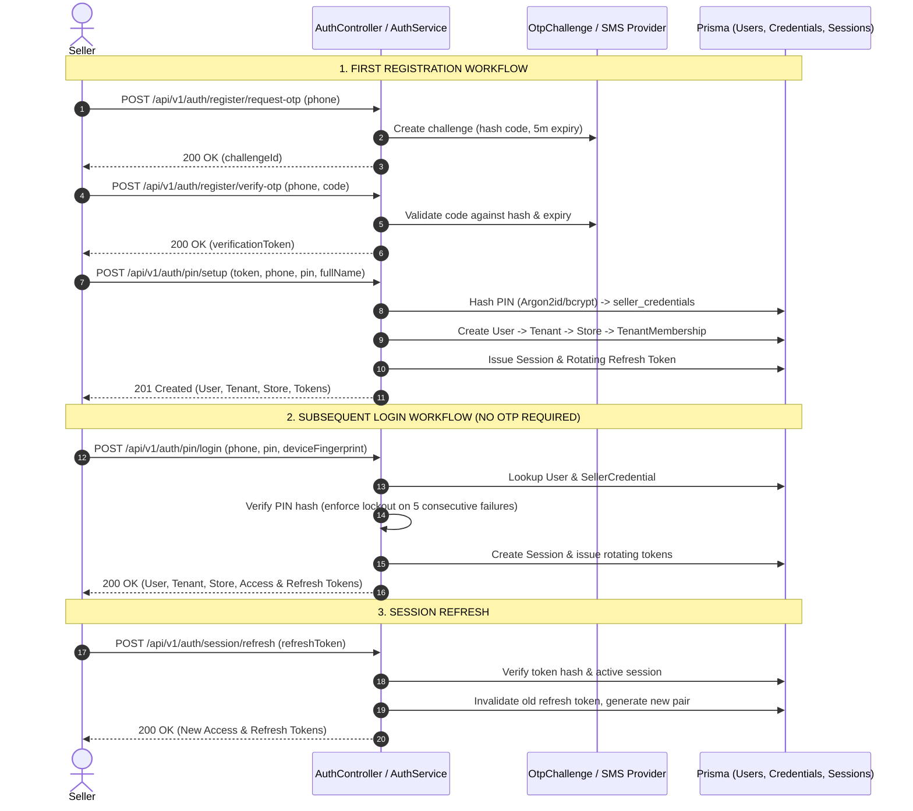
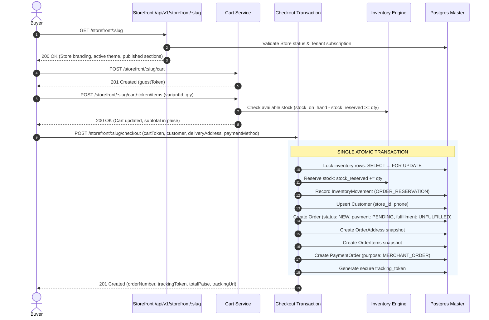
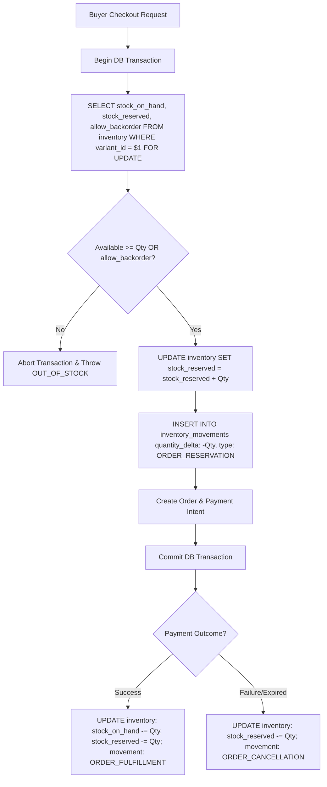
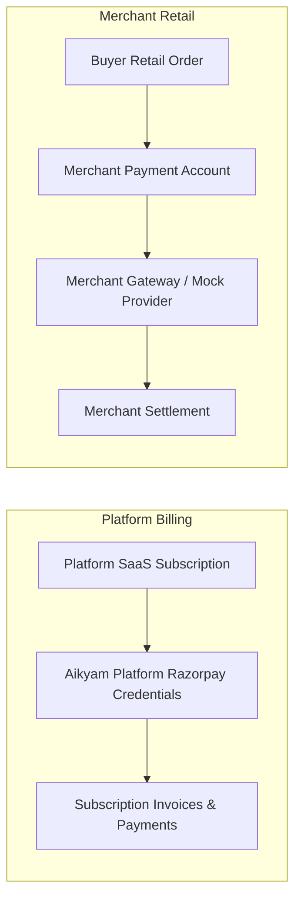
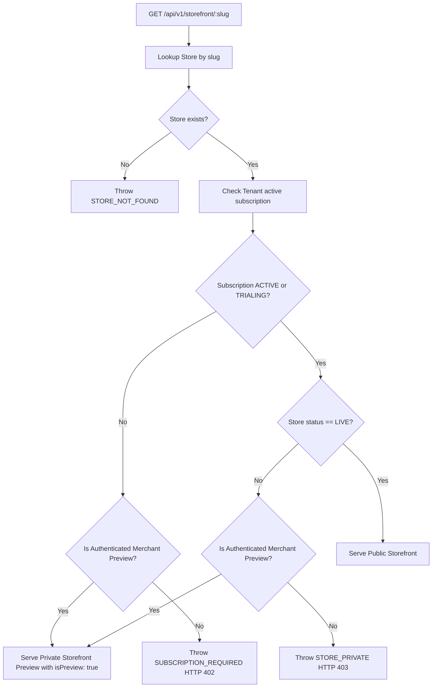

# SIMPLY E-COMMERCE — BACKEND FLOW & ARCHITECTURE SPECIFICATION

**Version:** 1.0.0 (Production Canonical Reset)  
**Scope:** Backend Execution Paths, State Machines, & Concurrency Invariants

---

## 1. Seller Authentication & Session Lifecycle

The Simply E-Commerce seller authentication model provides strong security, minimal login friction, and future-proof credential extensibility (passkeys/biometrics).



### 1.1 Invariants
- **No OTP Spam:** OTP is exclusively used for initial mobile verification and account recovery. Regular daily logins require only the seller's secure numeric PIN.
- **Fail-Closed in Production:** If `NODE_ENV === 'production'`, the hardcoded mock OTP (`123456`) is deactivated, and missing SMS provider credentials halt the challenge.
- **Hashed Secrets Only:** Neither plain PINs, refresh tokens, nor session secrets are stored in plaintext in the database.

---

## 2. Public Buyer Flow & Guest Checkout

There is no buyer login in V1. Storefronts are purely unauthenticated customer experiences.



### 2.1 Server-Owned Pricing Guarantee
1. When adding items to cart, unit price is pulled directly from `product_variants.price_paise`.
2. At checkout, line items are recalculated against current active database prices.
3. Shipping fees are computed via the active `ShippingProfile` (e.g. flat rate unless subtotal exceeds free shipping threshold in paise).
4. Taxes are computed as specified by product category or store tax rates.
5. The buyer cannot alter `total_paise` through client tampering.

---

## 3. Concurrency & Inventory Reservation Safety

Preventing overselling and race conditions is fundamental to Simply E-Commerce.



---

## 4. Payment Boundaries: Platform vs Merchant

The platform maintains strict credential and purpose boundaries:



- **Invariant:** Platform Razorpay credentials (`RAZORPAY_PLATFORM_KEY_ID`) are NEVER used to process merchant retail orders.
- **Merchant Gateway:** Each merchant configures their own payment account (`merchant_payment_accounts`) or uses the standard Mock provider during development.

---

## 5. Shipping Logistics Abstraction

Shipment creation is isolated behind the `ShippingProvider` interface:

```typescript
export interface ShippingProvider {
  createShipment(order: Order, profile: ShippingProfile): Promise<ShipmentResult>;
  cancelShipment(awbNumber: string): Promise<boolean>;
  getTracking(awbNumber: string): Promise<TrackingMilestone[]>;
}
```

- **Shiprocket Integration:** Designed as an adapter adhering to this interface. The core `OrderService` interacts purely with `ShippingProvider` and never contains direct carrier API calls.
- **Logistics State Machine:**
  `UNFULFILLED` -> `PROCESSING` -> `READY_TO_SHIP` -> `SHIPPED` -> `DELIVERED` (or `RETURN_REQUESTED` -> `RETURNED`).

---

## 6. SaaS Subscription Gating Flow

Storefront public visibility and checkout acceptance are strictly gated by the merchant's SaaS subscription status. The backend guarantees that **sellers never lose dashboard, catalog, or configuration access** even when their subscription is inactive or expired.

### 6.1 Permitted vs. Blocked Matrix

| Capability / Action | No Subscription / Inactive / Expired | Active Paid / Trialing Subscription |
| :--- | :---: | :---: |
| **Seller Login (PIN / Session)** | ✅ Allowed | ✅ Allowed |
| **Seller Dashboard & Metrics** | ✅ Allowed | ✅ Allowed |
| **Manage Catalog (Products, Categories, Options)** | ✅ Allowed | ✅ Allowed |
| **Manage Media Assets & Uploads** | ✅ Allowed | ✅ Allowed |
| **Configure Theme Tokens & Sections** | ✅ Allowed | ✅ Allowed |
| **Private Storefront Preview (`isPreview: true`)** | ✅ Allowed (with auth or secret) | ✅ Allowed |
| **Publish Storefront to Live (`POST /seller/store/publish`)** | ❌ Blocked (`SUBSCRIPTION_REQUIRED`) | ✅ Allowed (`status: LIVE`) |
| **Public Storefront Browsing (`GET /storefront/:slug`)** | ❌ Blocked (`SUBSCRIPTION_REQUIRED`) | ✅ Allowed |
| **Public Buyer Checkout (`POST /storefront/:slug/checkout`)** | ❌ Blocked (`SUBSCRIPTION_REQUIRED`) | ✅ Allowed |



### 6.2 Expiry, Cancellation, and Renewal Invariants
- **Data Preservation:** An expired subscription never truncates or alters merchant inventory, images, configurations, or order histories.
- **Immediate Public Shielding:** Upon subscription expiry (`now > currentPeriodEnd`), public buyers are instantly shielded from store browsing and order placement (`SUBSCRIPTION_REQUIRED`), but the merchant can immediately access their private preview and renew subscription.
