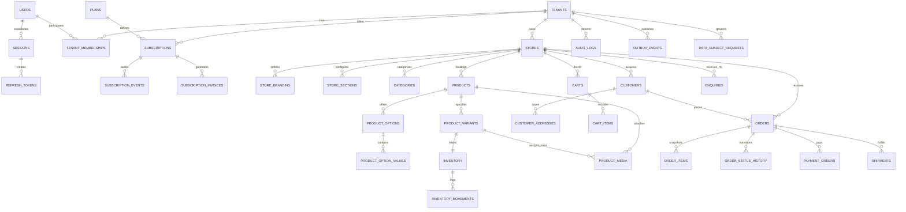

# Simply E-Commerce - Database Design & Schema Reference

## 1. Overview & Core Principles

The Simply E-Commerce persistence layer is built on PostgreSQL with Prisma ORM.

### Key Database Standards:
1. **Identifier Strategy**: Universally Unique Identifiers (UUIDv4) across all primary keys to prevent enumeration attacks and support distributed scaling.
2. **Monetary Precision**: All currency amounts are stored in **integer minor units** (paise). Example: ₹1,299.50 is stored as `129950`. Floating-point types are strictly forbidden for financial calculations.
3. **Multi-Tenancy Isolation**: Every tenant-owned business entity includes `tenant_id` and/or `store_id`. Compound indexes are optimized for tenant-scoped lookups.
4. **Soft Deletions**: Important domain entities (`users`, `tenants`, `stores`, `products`, `product_variants`) implement soft deletion via nullable `deleted_at` timestamps to preserve historical referential integrity.
5. **UTC Standard**: All timestamps (`created_at`, `updated_at`, `deleted_at`, `expires_at`) are recorded in UTC.

---

## 2. Entity-Relationship (ER) Diagram

---

## 3. Entity Catalog & Table Definitions

### 3.1 Auth & Tenancy

| Table Name | Description | Key Indexes & Constraints |
| :--- | :--- | :--- |
| `users` | Platform users (merchants, staff, superadmins) | `phone` (UNIQUE), `email` (UNIQUE) |
| `otp_requests` | Ephemeral mobile verification requests | `(phone, is_verified, expires_at)` |
| `sessions` | Server-side active login sessions | `token_hash` (UNIQUE), `(user_id, is_revoked, expires_at)` |
| `refresh_tokens` | Rotating cryptographically secure refresh tokens | `token_hash` (UNIQUE), `(token_hash, is_revoked)` |
| `tenants` | Merchant business entities / corporate accounts | `slug` (UNIQUE) |
| `tenant_memberships` | User-to-tenant role mapping | `(tenant_id, user_id)` (UNIQUE) |
| `stores` | Individual storefronts / branches | `slug` (UNIQUE), `(tenant_id, status)`, `(slug, is_publicly_accessible)` |

### 3.2 Subscription & Store Identity

| Table Name | Description | Key Indexes & Constraints |
| :--- | :--- | :--- |
| `plans` | Subscription tiers (Starter, Growth, Enterprise) | `code` (UNIQUE), `price_paise` |
| `subscriptions` | Active merchant subscription contracts | `(tenant_id, status)` |
| `subscription_events` | State transition audit trail for subscriptions | `(subscription_id, created_at)` |
| `subscription_invoices`| Invoices generated per billing cycle | `invoice_number` (UNIQUE) |
| `store_branding` | Visual identity (colors, fonts, announcement) | `store_id` (UNIQUE) |
| `store_sections` | Dynamic homepage blocks (hero, products, banner) | `(store_id, sort_order)` |
| `themes` | Reusable UI design system presets | `code` (UNIQUE) |

### 3.3 Catalog & Inventory

| Table Name | Description | Key Indexes & Constraints |
| :--- | :--- | :--- |
| `categories` | Product hierarchy categories | `(store_id, slug)` (UNIQUE), `(tenant_id, store_id, is_active)` |
| `products` | Product roots (modes: SELL_ONLINE, ENQUIRY_ONLY) | `(store_id, slug)` (UNIQUE), `(tenant_id, store_id, status)`, `name` |
| `product_options` | Attribute types (Colour, Size, Material, Custom) | `(product_id, name)` (UNIQUE) |
| `product_option_values`| Specific values (Navy, XL, Cotton, 128GB) | `(option_id, value)` (UNIQUE) |
| `product_variants` | SKU-level purchasable combinations | `(store_id, sku)` (UNIQUE), `(sku)` |
| `product_variant_option_values` | Join table for variant attribute values | `(variant_id, option_value_id)` (UNIQUE) |
| `product_media` | Image and media metadata (storage keys, URLs) | `(product_id, sort_order)`, `variant_id` |
| `inventory` | Real-time stock levels and reserved counters | `variant_id` (UNIQUE), `(tenant_id, store_id)` |
| `inventory_movements` | Immutable audit ledger of stock deltas | `(variant_id, created_at)`, `(tenant_id, store_id)` |

### 3.4 Customers, Carts & Orders

| Table Name | Description | Key Indexes & Constraints |
| :--- | :--- | :--- |
| `customers` | Guest and registered buyer contact profiles | `(tenant_id, store_id, phone)` |
| `customer_addresses` | Buyer delivery addresses | `customer_id` |
| `carts` | Guest and customer shopping carts | `guest_token` (UNIQUE), `(tenant_id, store_id)` |
| `cart_items` | Products in cart | `(cart_id, variant_id)` (UNIQUE) |
| `orders` | Placed customer orders | `order_number` (UNIQUE), `(tenant_id, store_id, status)` |
| `order_items` | Historical immutable snapshots of ordered items | `order_id` |
| `order_status_history` | State transition audit log for orders | `(order_id, created_at)` |

### 3.5 Payments & Shipping

| Table Name | Description | Key Indexes & Constraints |
| :--- | :--- | :--- |
| `merchant_payment_accounts` | Tenant Razorpay / Mock account credentials | `(store_id, provider)` (UNIQUE) |
| `payment_orders` | Gateway transaction orders | `(provider_order_id)`, `idempotency_key` (UNIQUE) |
| `payment_transactions` | Verified successful or refunded payments | `provider_payment_id` (UNIQUE) |
| `payment_webhook_events` | Webhook deduplication log | `event_id` (UNIQUE), `(provider, event_type, is_processed)` |
| `merchant_shipping_accounts` | Tenant Shiprocket / Mock account credentials | `(store_id, provider)` (UNIQUE) |
| `shipping_profiles` | Flat rate and free shipping thresholds | `(tenant_id, store_id)` |
| `shipments` | Courier consignments and manifests | `awb_number` (UNIQUE), `(tenant_id, store_id, status)` |
| `shipment_events` | Milestone tracking checkpoints | `(shipment_id, created_at)` |

### 3.6 Reliability, Audit & Privacy

| Table Name | Description | Key Indexes & Constraints |
| :--- | :--- | :--- |
| `enquiries` | B2B quotations and custom product RFQs | `(tenant_id, store_id, status)` |
| `audit_logs` | Immutable security audit trail | `(tenant_id, created_at)`, `(action, created_at)` |
| `idempotency_keys` | Anti-replay tokens for critical state changes | `key` (UNIQUE), `(key, status, expires_at)` |
| `outbox_events` | Transactional outbox events for background workers | `(status, next_retry_at)` |
| `consent_records` | DPDPA explicit consent logs | `(tenant_id, phone, purpose)` |
| `data_subject_requests` | DPDPA access and erasure requests | `(tenant_id, status)` |

---

## 4. PostgreSQL Indexing Strategy

1. **Catalog Search Acceleration**:
   - `CREATE INDEX ON products (name);`
   - `CREATE INDEX ON product_variants (sku);`
   - B-Tree compound index on `products (tenant_id, store_id, status)` ensures that storefront catalog queries bypass table scans.
2. **Storefront Resolution**:
   - `CREATE UNIQUE INDEX ON stores (slug);`
   - Index on `stores (slug, is_publicly_accessible)` guarantees instantaneous subscription verification.
3. **Outbox Polling Efficiency**:
   - Index on `outbox_events (status, next_retry_at)` ensures the background retry dispatcher evaluates only pending and eligible events with zero lock contention.
