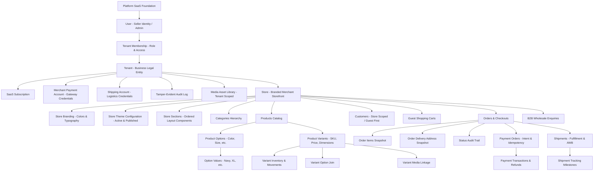

# SIMPLY E-COMMERCE — DATABASE ARCHITECTURE SPECIFICATION

**Version:** 1.0.0 (Production Canonical Reset)  
**Status:** Approved Architecture  
**Database Engine:** PostgreSQL 15+ / Neon / RDS  
**ORM:** Prisma 6.x

---

## 1. Architectural Principles

1. **Strict Multi-Tenancy Isolation:** Every merchant data point (products, inventory, media, orders, customers, carts, themes, sections) is rooted in a `Tenant` and owned by a `Store`. No cross-tenant reads, writes, or references are ever permitted.
2. **Server-Owned Pricing:** All prices, discounts, taxes, and shipping rates are calculated exclusively on the server. Client-provided prices or totals are rejected.
3. **Integer Minor-Unit Currency (Paise):** All monetary figures are stored as signed 32-bit or 64-bit integers representing Indian Paise (1 INR = 100 paise). Floating-point monetary fields are forbidden.
4. **Normalized Dynamic Variants:** No hardcoded options (color/size/material). Unlimited seller-defined product options (`ProductOption`), values (`ProductOptionValue`), matrix variants (`ProductVariant`), and mappings (`VariantOptionValue`).
5. **Decoupled Status Systems:** Statuses for Order lifecycle, Payment state, Fulfillment logistics, Store visibility, and Product catalog are separate enums.
6. **Concurrency-Safe Atomic Inventory:** Inventory reservations use transactional row locks (`SELECT ... FOR UPDATE`) or atomic SQL delta updates with balance checking (`stock_on_hand - stock_reserved >= quantity`). Stock never drops below zero unless backorders are explicitly enabled.
7. **Payment Purpose Boundary:** Platform SaaS subscriptions (`PLATFORM_SUBSCRIPTION`) are processed strictly through the platform Razorpay gateway. Merchant retail sales (`MERCHANT_ORDER`) are handled through the merchant's dedicated gateway credentials or mock provider.

---

## 2. Canonical Domain Hierarchy

---

## 3. Data Dictionary & Normalized Entity Models

### 3.1 Identity, Authentication & Security

#### `users`
Core human identity table. Sellers, staff, and platform administrators.
- `id` (UUID, Primary Key)
- `phone` (VARCHAR, UNIQUE, Indexed) — Canonical Indian mobile number format (`+91XXXXXXXXXX`).
- `email` (VARCHAR, UNIQUE, Nullable)
- `full_name` (VARCHAR)
- `role` (ENUM `UserRole`: `PLATFORM_ADMIN`, `SELLER_OWNER`, `SELLER_STAFF`)
- `is_super_admin` (BOOLEAN, default `false`)
- `is_active` (BOOLEAN, default `true`)
- `created_at`, `updated_at`, `deleted_at` (TIMESTAMP)

#### `seller_credentials`
Stores seller authentication credentials, decoupled from identity to allow future passkey / biometric adoption without schema alteration.
- `id` (UUID, Primary Key)
- `user_id` (UUID, Foreign Key -> `users.id`, UNIQUE with credential_type)
- `credential_type` (ENUM `CredentialType`: `PIN`, `PASSKEY`, `BIOMETRIC`)
- `pin_hash` (VARCHAR, Nullable) — Argon2id or bcrypt hash of 4-6 digit numeric PIN.
- `public_key` (TEXT, Nullable) — WebAuthn / Passkey public key credential.
- `failed_pin_attempts` (INT, default 0)
- `locked_until` (TIMESTAMP, Nullable)
- `created_at`, `updated_at` (TIMESTAMP)

#### `otp_challenges`
Ephemeral one-time password challenges for onboarding, recovery, and security step-up.
- `id` (UUID, Primary Key)
- `phone` (VARCHAR, Indexed)
- `purpose` (ENUM `OtpPurpose`: `REGISTRATION`, `LOGIN`, `RECOVERY`)
- `code_hash` (VARCHAR) — SHA-256 hash of generated 6-digit OTP.
- `attempts` (INT, default 0)
- `max_attempts` (INT, default 5)
- `is_verified` (BOOLEAN, default `false`)
- `expires_at` (TIMESTAMP)
- `verified_at` (TIMESTAMP, Nullable)
- `created_at` (TIMESTAMP)

#### `sessions`
Server-side rotating seller sessions.
- `id` (UUID, Primary Key)
- `user_id` (UUID, Foreign Key -> `users.id`)
- `tenant_id` (UUID, Nullable)
- `store_id` (UUID, Nullable)
- `device_id` (UUID, Nullable, Foreign Key -> `devices.id`)
- `token_hash` (VARCHAR, UNIQUE, Indexed) — SHA-256 hash of high-entropy session token.
- `ip_address` (VARCHAR, Nullable)
- `user_agent` (TEXT, Nullable)
- `is_revoked` (BOOLEAN, default `false`)
- `expires_at` (TIMESTAMP)
- `last_active_at` (TIMESTAMP)
- `created_at`, `updated_at` (TIMESTAMP)

#### `devices`
Registered seller hardware devices.
- `id` (UUID, Primary Key)
- `user_id` (UUID, Foreign Key -> `users.id`)
- `device_fingerprint` (VARCHAR)
- `device_name` (VARCHAR, Nullable)
- `user_agent` (TEXT, Nullable)
- `last_ip` (VARCHAR, Nullable)
- `is_trusted` (BOOLEAN, default `false`)
- `last_seen_at` (TIMESTAMP)
- `created_at` (TIMESTAMP)

---

### 3.2 Tenancy & Stores

#### `tenants`
The business organization boundary.
- `id` (UUID, Primary Key)
- `name` (VARCHAR)
- `slug` (VARCHAR, UNIQUE, Indexed)
- `status` (ENUM `TenantStatus`: `ACTIVE`, `SUSPENDED`, `ARCHIVED`)
- `created_at`, `updated_at`, `deleted_at` (TIMESTAMP)

#### `tenant_memberships`
Role-based access mapping between users and tenants.
- `id` (UUID, Primary Key)
- `tenant_id` (UUID, Foreign Key -> `tenants.id`)
- `user_id` (UUID, Foreign Key -> `users.id`)
- `role` (ENUM `UserRole`: `SELLER_OWNER`, `SELLER_STAFF`)
- `is_active` (BOOLEAN, default `true`)
- Unique constraint: `(tenant_id, user_id)`

#### `stores`
Merchant branded digital storefront.
- `id` (UUID, Primary Key)
- `tenant_id` (UUID, Foreign Key -> `tenants.id`)
- `name` (VARCHAR)
- `slug` (VARCHAR, UNIQUE, Indexed) — Used in `/store/:slug`.
- `description` (TEXT, Nullable)
- `status` (ENUM `StoreStatus`: `DRAFT`, `PRIVATE_PREVIEW`, `LIVE`, `SUSPENDED`)
- `default_currency` (VARCHAR(3), default `'INR'`)
- `timezone` (VARCHAR, default `'Asia/Kolkata'`)
- `support_phone` (VARCHAR, Nullable) — Customer care phone number.
- `support_email` (VARCHAR, Nullable) — Customer care email.
- `whatsapp_number` (VARCHAR, Nullable) — Customer support WhatsApp direct channel.
- `business_address` (TEXT, Nullable) — Physical store/warehouse address.
- `maps_url` (VARCHAR, Nullable) — Google Maps navigation link.
- `social_links` (JSONB, Nullable) — Instagram, Facebook, LinkedIn, Twitter links.
- `fulfillment_mode` (ENUM `FulfillmentMode`: `DELIVERY`, `PICKUP`, `DELIVERY_AND_PICKUP`, default `DELIVERY`)
- `is_publicly_accessible` (BOOLEAN, default `false`)
- `preview_secret` (VARCHAR) — High-entropy token for private merchant previews.
- `created_at`, `updated_at`, `deleted_at` (TIMESTAMP)

#### `store_business_hours`
Weekly operating schedule for fulfillment, local pickups, and delivery readiness.
- `id` (UUID, Primary Key)
- `store_id` (UUID, Foreign Key -> `stores.id`, Indexed)
- `day_of_week` (INT) — 0 (Sunday) to 6 (Saturday).
- `open_time` (VARCHAR) — e.g. `'09:00'`
- `close_time` (VARCHAR) — e.g. `'21:00'`
- `is_closed` (BOOLEAN, default `false`)
- `created_at`, `updated_at` (TIMESTAMP)
- Unique constraint: `(store_id, day_of_week)`

---

### 3.3 Themes, Branding & Storefront Sections

#### `theme_definitions`
Platform-provided foundational storefront design engines (all 7 canonical themes).
- `id` (UUID, Primary Key)
- `key` (ENUM `ThemeKey`: `ATELIER`, `PULSE`, `HARVEST`, `FOUNDRY`, `HABITAT`, `LOCAL`, `FEAST`, UNIQUE)
- `name` (VARCHAR)
- `version` (VARCHAR, default `'1.0.0'`)
- `description` (TEXT, Nullable) — Summary of visual archetype and aesthetics.
- `category_fit` (VARCHAR)
- `default_config` (JSONB)
- `capabilities` (JSONB) — Common & specialized backend capability descriptors.
- `status` (VARCHAR, default `'ACTIVE'`)
- `created_at`, `updated_at` (TIMESTAMP)

#### `store_theme_configurations`
Store-level custom configuration of an active theme definition.
- `id` (UUID, Primary Key)
- `store_id` (UUID, Foreign Key -> `stores.id`, UNIQUE)
- `theme_definition_id` (UUID, Foreign Key -> `theme_definitions.id`)
- `theme_version` (VARCHAR)
- `configuration` (JSONB) — Active working configuration (draft).
- `published_configuration` (JSONB) — Live public storefront configuration.
- `created_at`, `updated_at` (TIMESTAMP)

#### `store_sections`
Individual modular components rendered on a store's homepage.
- `id` (UUID, Primary Key)
- `store_id` (UUID, Foreign Key -> `stores.id`, Indexed)
- `type` (ENUM `SectionType`: `HERO`, `CATEGORIES`, `FEATURED_COLLECTION`, `NEW_ARRIVALS`, `BESTSELLERS`, `STORY`, `TESTIMONIALS`, `PHYSICAL_STORE`, `CUSTOM_BANNER`, `CONTACT`)
- `position` (INT, default 0) — Order of appearance.
- `enabled` (BOOLEAN, default `true`)
- `configuration` (JSONB) — Section-specific headings, image keys, product query rules.
- `created_at`, `updated_at` (TIMESTAMP)

#### `store_branding`
Store brand identity tokens.
- `id` (UUID, Primary Key)
- `store_id` (UUID, Foreign Key -> `stores.id`, UNIQUE)
- `logo_url` (VARCHAR, Nullable)
- `favicon_url` (VARCHAR, Nullable)
- `primary_color` (VARCHAR, default `'#1E40AF'`)
- `accent_color` (VARCHAR, default `'#F59E0B'`)
- `font_heading` (VARCHAR, default `'Inter'`)
- `font_body` (VARCHAR, default `'Inter'`)
- `announcement` (TEXT, Nullable)
- `created_at`, `updated_at` (TIMESTAMP)

---

### 3.4 Media Asset Storage

#### `media_assets`
Tenant-scoped media library. Binary files reside behind the `StorageProvider` abstraction (Local FS, Cloudflare R2, AWS S3).
- `id` (UUID, Primary Key)
- `tenant_id` (UUID, Foreign Key -> `tenants.id`, Indexed)
- `store_id` (UUID, Nullable, Foreign Key -> `stores.id`, Indexed)
- `storage_provider` (VARCHAR, default `'LOCAL'`) — Provider pluggable interface (`LOCAL`, `CLOUDFLARE_R2`, `S3`).
- `storage_key` (VARCHAR, UNIQUE) — Relative storage identifier (e.g. `tenant_xyz/prod_123.jpg`).
- `public_url` (VARCHAR) — Fully-qualified public URL served by storage provider.
- `file_name` (VARCHAR)
- `mime_type` (VARCHAR)
- `size_bytes` (INT)
- `checksum` (VARCHAR, Nullable) — Cryptographic integrity hash (SHA-256).
- `width` (INT, Nullable)
- `height` (INT, Nullable)
- `alt_text` (VARCHAR, Nullable)
- `focal_point_x` (FLOAT, default 0.5) — Dynamic smart crop horizontal center (0.0 to 1.0).
- `focal_point_y` (FLOAT, default 0.5) — Dynamic smart crop vertical center (0.0 to 1.0).
- `metadata` (JSONB, Nullable) — EXIF / processing metadata.
- `created_at`, `updated_at`, `deleted_at` (TIMESTAMP)

---

### 3.5 Catalog & Normalized Product Variants

#### `categories`
Hierarchical product categorization.
- `id` (UUID, Primary Key)
- `tenant_id` (UUID, Foreign Key -> `tenants.id`)
- `store_id` (UUID, Foreign Key -> `stores.id`)
- `name` (VARCHAR)
- `slug` (VARCHAR)
- `description` (TEXT, Nullable)
- `parent_id` (UUID, Nullable, Self-relation -> `categories.id`)
- `sort_order` (INT, default 0)
- `is_active` (BOOLEAN, default `true`)
- Unique constraint: `(store_id, slug)`

#### `products`
The base product definition.
- `id` (UUID, Primary Key)
- `tenant_id` (UUID, Foreign Key -> `tenants.id`)
- `store_id` (UUID, Foreign Key -> `stores.id`)
- `category_id` (UUID, Nullable, Foreign Key -> `categories.id`)
- `name` (VARCHAR, Indexed)
- `slug` (VARCHAR)
- `description` (TEXT, Nullable)
- `mode` (ENUM `ProductMode`: `SELL_ONLINE`, `ENQUIRY_ONLY`, `SELL_AND_ENQUIRY`)
- `status` (ENUM `ProductStatus`: `DRAFT`, `ACTIVE`, `ARCHIVED`)
- `min_order_quantity` (INT, default 1)
- `lead_time_days` (INT, Nullable)
- `brochure_url` (VARCHAR, Nullable)
- `specifications` (JSONB, Nullable) — Key-value pairs for technical specs.
- `enquiry_cta_text` (VARCHAR, default `'Request Quotation'`)
- `created_at`, `updated_at`, `deleted_at` (TIMESTAMP)
- Unique constraint: `(store_id, slug)`

#### `product_options`
Seller-defined option dimensions (Color, Size, Material, Storage, Pack Size, Finish, etc.).
- `id` (UUID, Primary Key)
- `tenant_id` (UUID, Foreign Key -> `tenants.id`)
- `store_id` (UUID, Foreign Key -> `stores.id`)
- `product_id` (UUID, Foreign Key -> `products.id`, Indexed)
- `name` (VARCHAR) — e.g. "Color", "Size", "Capacity".
- `sort_order` (INT, default 0)
- `created_at`, `updated_at` (TIMESTAMP)
- Unique constraint: `(product_id, name)`

#### `product_option_values`
Values for an option dimension.
- `id` (UUID, Primary Key)
- `option_id` (UUID, Foreign Key -> `product_options.id`, Indexed)
- `value` (VARCHAR) — e.g. "Sapphire Blue", "XXL", "128GB".
- `color_hex` (VARCHAR, Nullable) — Visual swatch representation (e.g. `#000080`).
- `sort_order` (INT, default 0)
- Unique constraint: `(option_id, value)`

#### `product_variants`
The sellable SKU unit.
- `id` (UUID, Primary Key)
- `tenant_id` (UUID, Foreign Key -> `tenants.id`)
- `store_id` (UUID, Foreign Key -> `stores.id`)
- `product_id` (UUID, Foreign Key -> `products.id`, Indexed)
- `sku` (VARCHAR, Indexed)
- `barcode` (VARCHAR, Nullable)
- `price_paise` (INT) — Mandatory base unit price.
- `compare_at_price_paise` (INT, Nullable) — Strikethrough comparison price.
- `cost_price_paise` (INT, Nullable) — Seller margin tracking.
- `status` (ENUM `VariantStatus`: `ACTIVE`, `INACTIVE`, `DISCONTINUED`)
- `weight_grams` (INT, Nullable)
- `length_cm` (FLOAT, Nullable)
- `width_cm` (FLOAT, Nullable)
- `height_cm` (FLOAT, Nullable)
- `sort_order` (INT, default 0)
- Unique constraint: `(store_id, sku)`

#### `product_variant_option_values`
Join table mapping variant to its constituent option values.
- `id` (UUID, Primary Key)
- `variant_id` (UUID, Foreign Key -> `product_variants.id`)
- `option_value_id` (UUID, Foreign Key -> `product_option_values.id`)
- Unique constraint: `(variant_id, option_value_id)`

#### `product_media`
Variant-specific and product-level image associations.
- `id` (UUID, Primary Key)
- `tenant_id` (UUID, Foreign Key -> `tenants.id`)
- `store_id` (UUID, Foreign Key -> `stores.id`)
- `product_id` (UUID, Foreign Key -> `products.id`, Indexed)
- `variant_id` (UUID, Nullable, Foreign Key -> `product_variants.id`, Indexed)
- `media_asset_id` (UUID, Nullable, Foreign Key -> `media_assets.id`)
- `storage_key` (VARCHAR)
- `public_url` (VARCHAR)
- `alt_text` (VARCHAR, Nullable)
- `sort_order` (INT, default 0)

#### `product_attributes`
Generic, seller-defined, product-scoped specifications and parameters across all industries without category-specific DB columns.
- `id` (UUID, Primary Key)
- `product_id` (UUID, Foreign Key -> `products.id`, Indexed)
- `name` (VARCHAR) — e.g. `'Material'`, `'Pressure'`, `'Shelf Life'`, `'Fabric'`, `'Voltage'`, `'Serves'`
- `value` (VARCHAR) — e.g. `'SS316'`, `'PN40'`, `'7 Days'`, `'Linen'`, `'220V'`, `'4'`
- `type` (VARCHAR, default `'TEXT'`) — `'TEXT'`, `'NUMBER'`, `'BADGE'`, `'DIMENSION'`, `'BOOLEAN'`
- `sort_order` (INT, default 0)
- `created_at`, `updated_at` (TIMESTAMP)
- Unique constraint: `(product_id, name)`

#### `product_documents`
Generic downloadable technical documents, compliance sheets, and drawings for B2B/industrial products.
- `id` (UUID, Primary Key)
- `tenant_id` (UUID, Foreign Key -> `tenants.id`)
- `store_id` (UUID, Foreign Key -> `stores.id`, Indexed)
- `product_id` (UUID, Foreign Key -> `products.id`, Indexed)
- `media_asset_id` (UUID, Nullable, Foreign Key -> `media_assets.id`)
- `title` (VARCHAR) — e.g. `'Technical Datasheet'`, `'ISO 9001 Certificate'`, `'CAD Drawing'`
- `doc_type` (VARCHAR, default `'DATASHEET'`) — `'BROCHURE'`, `'DATASHEET'`, `'DRAWING'`, `'MANUAL'`, `'CERTIFICATE'`
- `file_url` (VARCHAR) — Fully-qualified download URL
- `file_size_mb` (FLOAT, Nullable)
- `sort_order` (INT, default 0)
- `created_at`, `updated_at` (TIMESTAMP)

---

### 3.6 Concurrency-Safe Inventory

#### `inventory`
Stock levels per variant.
- `id` (UUID, Primary Key)
- `tenant_id` (UUID, Foreign Key -> `tenants.id`)
- `store_id` (UUID, Foreign Key -> `stores.id`)
- `variant_id` (UUID, Foreign Key -> `product_variants.id`, UNIQUE, Indexed)
- `stock_on_hand` (INT, default 0)
- `stock_reserved` (INT, default 0)
- `safety_stock_threshold` (INT, default 0)
- `allow_backorder` (BOOLEAN, default `false`)
- `updated_at` (TIMESTAMP)

#### `inventory_movements`
Immutable double-entry stock ledger.
- `id` (UUID, Primary Key)
- `tenant_id` (UUID, Foreign Key -> `tenants.id`)
- `store_id` (UUID, Foreign Key -> `stores.id`)
- `variant_id` (UUID, Foreign Key -> `product_variants.id`, Indexed)
- `inventory_id` (UUID, Foreign Key -> `inventory.id`)
- `movement_type` (ENUM `InventoryMovementType`: `INITIAL_STOCK`, `MANUAL_ADJUSTMENT`, `ORDER_RESERVATION`, `ORDER_FULFILLMENT`, `ORDER_CANCELLATION`, `RETURN_RESTOCK`)
- `quantity_delta` (INT) — Positive for additions, negative for deductions.
- `balance_after` (INT) — Resulting available or on-hand balance.
- `reference_type` (VARCHAR, Nullable) — e.g. `'ORDER'`, `'MANUAL'`.
- `reference_id` (VARCHAR, Nullable)
- `notes` (TEXT, Nullable)
- `actor_id` (VARCHAR, Nullable)
- `created_at` (TIMESTAMP, Indexed)

---

### 3.7 Customers, Guest Carts & Orders

#### `customers`
Store-scoped buyer profile. In V1, customers are created automatically during guest checkout.
- `id` (UUID, Primary Key)
- `tenant_id` (UUID, Foreign Key -> `tenants.id`)
- `store_id` (UUID, Foreign Key -> `stores.id`, Indexed)
- `phone` (VARCHAR, Indexed)
- `email` (VARCHAR, Nullable)
- `full_name` (VARCHAR)
- `is_guest` (BOOLEAN, default `true`)
- `notes` (TEXT, Nullable)
- `created_at`, `updated_at` (TIMESTAMP)

#### `customer_addresses`
Saved delivery locations.
- `id` (UUID, Primary Key)
- `customer_id` (UUID, Foreign Key -> `customers.id`, Indexed)
- `address_line1` (VARCHAR)
- `address_line2` (VARCHAR, Nullable)
- `landmark` (VARCHAR, Nullable)
- `city` (VARCHAR)
- `state` (VARCHAR)
- `pincode` (VARCHAR)
- `country` (VARCHAR, default `'India'`)
- `is_default` (BOOLEAN, default `false`)

#### `carts` & `cart_items`
Guest-first shopping cart session.
- `carts.id` (UUID, Primary Key)
- `carts.tenant_id`, `carts.store_id` (UUID, Indexed)
- `carts.guest_token` (VARCHAR, UNIQUE, Indexed)
- `carts.customer_id` (UUID, Nullable)
- `carts.expires_at` (TIMESTAMP)
- `cart_items.id` (UUID, Primary Key)
- `cart_items.cart_id` (UUID, Foreign Key -> `carts.id`, Cascade)
- `cart_items.variant_id` (UUID, Foreign Key -> `product_variants.id`)
- `cart_items.quantity` (INT, default 1)
- `cart_items.unit_price_paise` (INT)
- Unique constraint: `(cart_id, variant_id)`

#### `orders`
The master commerce contract.
- `id` (UUID, Primary Key)
- `tenant_id` (UUID, Foreign Key -> `tenants.id`)
- `store_id` (UUID, Foreign Key -> `stores.id`, Indexed)
- `customer_id` (UUID, Foreign Key -> `customers.id`)
- `order_number` (VARCHAR, UNIQUE, Indexed) — Human-readable identifier (e.g. `ORD-2026-A1B2C3`).
- `status` (ENUM `OrderStatus`: `NEW`, `CONFIRMED`, `CANCELLED`, `COMPLETED`)
- `payment_status` (ENUM `PaymentStatus`: `PENDING`, `AUTHORIZED`, `PAID`, `FAILED`, `PARTIALLY_REFUNDED`, `REFUNDED`)
- `fulfillment_status` (ENUM `FulfillmentStatus`: `UNFULFILLED`, `PROCESSING`, `READY_TO_SHIP`, `SHIPPED`, `DELIVERED`, `RETURN_REQUESTED`, `RETURNED`, `CANCELLED`)
- `subtotal_paise` (INT)
- `tax_paise` (INT, default 0)
- `shipping_paise` (INT, default 0)
- `discount_paise` (INT, default 0)
- `total_paise` (INT)
- `currency` (VARCHAR(3), default `'INR'`)
- `delivery_address` (JSONB) — Address snapshot.
- `guest_checkout` (BOOLEAN, default `true`)
- `tracking_token` (VARCHAR, UNIQUE, Indexed) — High-entropy token required to track guest orders.
- `created_at`, `updated_at`, `cancelled_at` (TIMESTAMP)

#### `order_addresses`
Normalized immutable delivery address snapshot.
- `id` (UUID, Primary Key)
- `order_id` (UUID, Foreign Key -> `orders.id`, UNIQUE)
- `full_name` (VARCHAR)
- `phone` (VARCHAR)
- `address_line1` (VARCHAR)
- `address_line2` (VARCHAR, Nullable)
- `landmark` (VARCHAR, Nullable)
- `city` (VARCHAR)
- `state` (VARCHAR)
- `pincode` (VARCHAR)
- `country` (VARCHAR, default `'India'`)
- `created_at` (TIMESTAMP)

#### `order_items`
Immutable snapshot of ordered variants.
- `id` (UUID, Primary Key)
- `order_id` (UUID, Foreign Key -> `orders.id`, Cascade)
- `variant_id` (UUID, Nullable, Foreign Key -> `product_variants.id`, SetNull)
- `product_name` (VARCHAR)
- `variant_title` (VARCHAR)
- `sku` (VARCHAR)
- `selected_options` (JSONB) — e.g. `{"Color": "Navy Blue", "Size": "XL"}`.
- `quantity` (INT)
- `unit_price_paise` (INT)
- `tax_paise` (INT, default 0)
- `total_paise` (INT)

#### `order_status_history`
Audit log of all order state transitions.
- `id` (UUID, Primary Key)
- `order_id` (UUID, Foreign Key -> `orders.id`, Cascade, Indexed)
- `from_status` (VARCHAR, Nullable)
- `to_status` (VARCHAR)
- `reason` (TEXT, Nullable)
- `actor_id` (VARCHAR, Nullable)
- `created_at` (TIMESTAMP)

---

### 3.8 Payments & Gateways

#### `merchant_payment_accounts`
Merchant gateway credentials (abstracted for pluggable providers).
- `id` (UUID, Primary Key)
- `tenant_id` (UUID, Foreign Key -> `tenants.id`)
- `store_id` (UUID, Foreign Key -> `stores.id`)
- `provider` (ENUM `PaymentProviderType`: `MOCK`, `RAZORPAY`)
- `is_enabled` (BOOLEAN, default `true`)
- `connection_status` (VARCHAR, default `'NOT_CONNECTED'`)
- `kyc_status` (VARCHAR, default `'NOT_STARTED'`)
- `key_id` (VARCHAR)
- `key_secret_encrypted` (VARCHAR)
- `webhook_secret_encrypted` (VARCHAR, Nullable)
- `merchant_account_id` (VARCHAR, Nullable)
- `capabilities` (JSONB, Nullable)
- Unique constraint: `(store_id, provider)`

#### `payment_orders`
Payment intent records.
- `id` (UUID, Primary Key)
- `tenant_id` (UUID, Foreign Key -> `tenants.id`)
- `store_id` (UUID, Foreign Key -> `stores.id`)
- `order_id` (UUID, Nullable, Foreign Key -> `orders.id`)
- `subscription_id` (UUID, Nullable, Foreign Key -> `subscriptions.id`)
- `purpose` (ENUM `PaymentPurpose`: `PLATFORM_SUBSCRIPTION`, `MERCHANT_ORDER`)
- `provider` (ENUM `PaymentProviderType`: `MOCK`, `RAZORPAY`)
- `provider_order_id` (VARCHAR, Indexed)
- `amount_paise` (INT)
- `currency` (VARCHAR(3), default `'INR'`)
- `status` (ENUM `PaymentStatus`: `PENDING`, `AUTHORIZED`, `PAID`, `FAILED`, `REFUNDED`, `PARTIALLY_REFUNDED`)
- `idempotency_key` (VARCHAR, UNIQUE, Indexed)
- `receipt` (VARCHAR, Nullable)
- `created_at`, `updated_at` (TIMESTAMP)

#### `payment_transactions` & `refunds`
Completed financial transactions.
- `payment_transactions.id` (UUID, Primary Key)
- `payment_transactions.payment_order_id` (UUID, Foreign Key -> `payment_orders.id`)
- `payment_transactions.provider_payment_id` (VARCHAR, UNIQUE)
- `payment_transactions.provider_signature` (VARCHAR, Nullable)
- `payment_transactions.status` (ENUM `PaymentStatus`)
- `payment_transactions.amount_paise` (INT)
- `payment_transactions.fee_paise` (INT, Nullable)
- `payment_transactions.tax_paise` (INT, Nullable)
- `payment_transactions.payment_method` (VARCHAR, Nullable)
- `refunds.id` (UUID, Primary Key)
- `refunds.order_id` (UUID, Foreign Key -> `orders.id`)
- `refunds.payment_transaction_id` (UUID, Foreign Key -> `payment_transactions.id`)
- `refunds.provider_refund_id` (VARCHAR, UNIQUE, Nullable)
- `refunds.amount_paise` (INT)
- `refunds.status` (VARCHAR, default `'PROCESSED'`)

#### `payment_webhook_events`
Deduplicated webhook events.
- `id` (UUID, Primary Key)
- `provider` (VARCHAR)
- `purpose` (ENUM `PaymentPurpose`)
- `event_id` (VARCHAR, UNIQUE, Indexed)
- `event_type` (VARCHAR)
- `payload` (JSONB)
- `payload_hash` (VARCHAR, Nullable)
- `status` (VARCHAR, default `'RECEIVED'`)
- `retry_count` (INT, default 0)
- `is_processed` (BOOLEAN, default `false`)
- `processed_at` (TIMESTAMP, Nullable)

---

### 3.9 Shipping & Logistics

#### `merchant_shipping_accounts`
Shipping partner credentials (e.g. Shiprocket, Delhivery, Mock).
- `id` (UUID, Primary Key)
- `tenant_id` (UUID, Foreign Key -> `tenants.id`)
- `store_id` (UUID, Foreign Key -> `stores.id`)
- `provider` (ENUM `ShippingProviderType`: `MOCK`, `SHIPROCKET`)
- `is_enabled` (BOOLEAN, default `true`)
- `api_key_encrypted` (VARCHAR)
- `api_secret_encrypted` (VARCHAR)
- `account_id` (VARCHAR, Nullable)
- Unique constraint: `(store_id, provider)`

#### `shipping_profiles`
Storefront shipping calculation rules.
- `id` (UUID, Primary Key)
- `tenant_id` (UUID, Foreign Key -> `tenants.id`)
- `store_id` (UUID, Foreign Key -> `stores.id`)
- `name` (VARCHAR)
- `flat_rate_paise` (INT, default 0)
- `free_shipping_threshold_paise` (INT, Nullable)
- `is_default` (BOOLEAN, default `true`)

#### `shipments` & `shipment_events`
Physical order fulfillment parcels and carrier milestones.
- `shipments.id` (UUID, Primary Key)
- `shipments.order_id` (UUID, Foreign Key -> `orders.id`, Cascade)
- `shipments.provider` (VARCHAR, default `'MOCK'`)
- `shipments.awb_number` (VARCHAR, UNIQUE, Nullable)
- `shipments.courier_name` (VARCHAR, Nullable)
- `shipments.tracking_url` (VARCHAR, Nullable)
- `shipments.status` (ENUM `FulfillmentStatus`)
- `shipments.label_url` (VARCHAR, Nullable)
- `shipments.weight_kg` (FLOAT, Nullable)
- `shipments.length_cm`, `shipments.width_cm`, `shipments.height_cm` (FLOAT, Nullable)
- `shipment_events.shipment_id` (UUID, Foreign Key -> `shipments.id`, Cascade)
- `shipment_events.status` (VARCHAR)
- `shipment_events.location` (VARCHAR, Nullable)
- `shipment_events.event_timestamp` (TIMESTAMP, Nullable)

---

### 3.10 B2B Enquiries & Quotations

#### `enquiries`
Wholesale and custom quotation requests.
- `id` (UUID, Primary Key)
- `tenant_id` (UUID, Foreign Key -> `tenants.id`)
- `store_id` (UUID, Foreign Key -> `stores.id`, Indexed)
- `product_id` (UUID, Nullable, Foreign Key -> `products.id`)
- `customer_name` (VARCHAR)
- `customer_phone` (VARCHAR)
- `customer_email` (VARCHAR, Nullable)
- `company_name` (VARCHAR, Nullable)
- `message` (TEXT)
- `requested_quantity` (INT, default 1)
- `status` (ENUM `EnquiryStatus`: `NEW`, `IN_REVIEW`, `QUOTATION_SENT`, `ACCEPTED`, `REJECTED`, `CLOSED`)
- `quotation_amount_paise` (INT, Nullable)
- `notes` (TEXT, Nullable)
- `created_at`, `updated_at` (TIMESTAMP)

---

### 3.11 Subscriptions & Governance

#### `plans` & `subscriptions`
Platform SaaS billing. Controls whether a store can be `LIVE`.
- `plans.id` (UUID, Primary Key)
- `plans.code` (VARCHAR, UNIQUE) — e.g. `'GROWTH'`, `'PRO'`, `'ENTERPRISE'`.
- `plans.price_paise` (INT)
- `subscriptions.id` (UUID, Primary Key)
- `subscriptions.tenant_id` (UUID, Foreign Key -> `tenants.id`, Indexed)
- `subscriptions.plan_id` (UUID, Foreign Key -> `plans.id`)
- `subscriptions.status` (ENUM `SubscriptionStatus`: `TRIALING`, `ACTIVE`, `PAST_DUE`, `CANCELED`, `UNPAID`, `EXPIRED`)
- `subscriptions.current_period_start`, `subscriptions.current_period_end` (TIMESTAMP)
- `subscription_invoices.id` (UUID, Primary Key)
- `subscription_invoices.amount_paise` (INT)
- `subscription_invoices.invoice_number` (VARCHAR, UNIQUE)

#### `audit_logs`
Tamper-evident system activity log.
- `id` (UUID, Primary Key)
- `actor_id` (VARCHAR, Nullable)
- `actor_type` (VARCHAR, default `'USER'`)
- `tenant_id` (UUID, Nullable, Indexed)
- `store_id` (UUID, Nullable)
- `action` (VARCHAR, Indexed) — e.g. `'ORDER_CONFIRMED'`, `'PRODUCT_CREATED'`.
- `entity_type` (VARCHAR)
- `entity_id` (VARCHAR, Nullable)
- `metadata` (JSONB, Nullable)
- `ip_address` (VARCHAR, Nullable)
- `user_agent` (TEXT, Nullable)
- `request_id` (VARCHAR, Nullable)
- `created_at` (TIMESTAMP, Indexed)

#### `idempotency_keys` & `outbox_events`
Reliability and exactly-once execution.
- `idempotency_keys.key` (VARCHAR, UNIQUE, Indexed)
- `idempotency_keys.request_hash` (VARCHAR)
- `idempotency_keys.status` (ENUM `IdempotencyStatus`: `IN_PROGRESS`, `COMPLETED`, `FAILED`)
- `outbox_events.id` (UUID, Primary Key)
- `outbox_events.status` (ENUM `OutboxStatus`: `PENDING`, `PROCESSING`, `COMPLETED`, `FAILED`, `DEAD_LETTER`)
