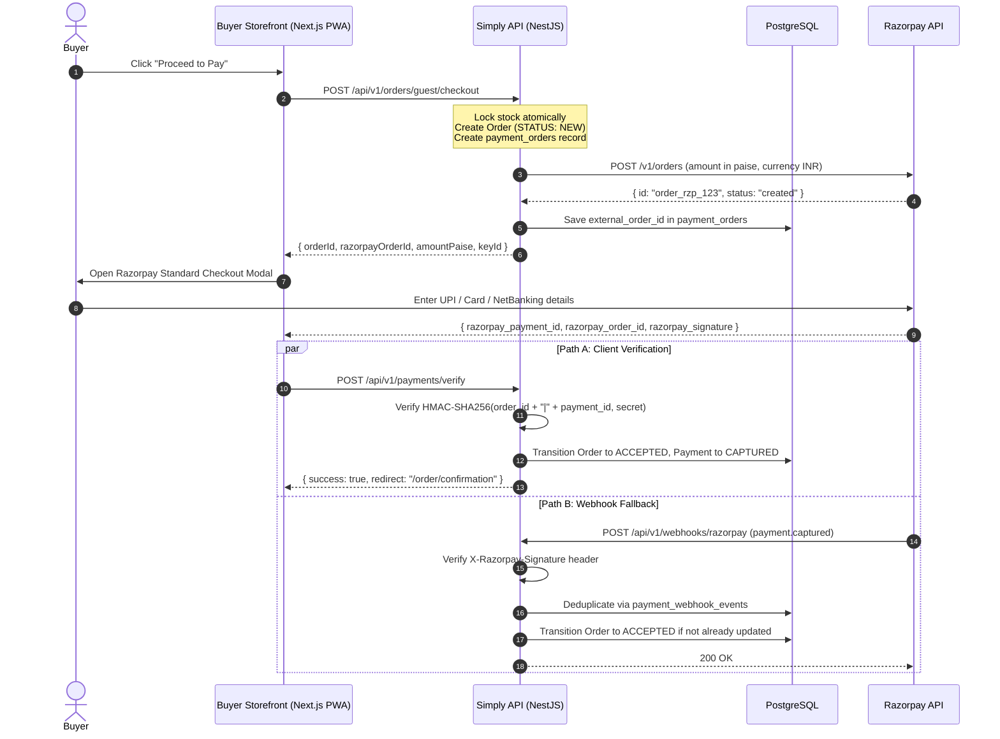
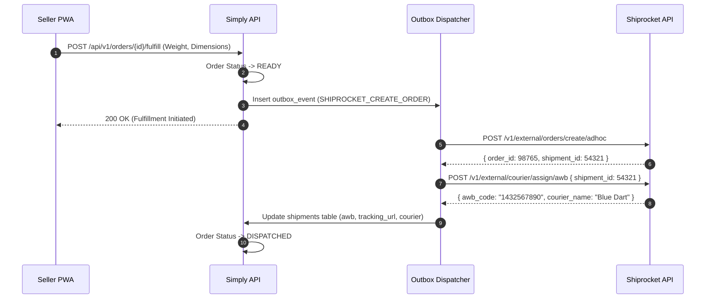

# Third-Party Integration Architecture: Razorpay & Shiprocket

This document specifies the integration architecture, authentication, failure handling, webhook security, and mock strategies for external payment and logistics providers in **Simply E-Commerce**.

---

## 1. Architectural Principles

1. **Strict Payment Boundary & Flow Separation**:
   In Simply E-Commerce, there are two completely separate financial flows:
   - **`PLATFORM_SUBSCRIPTION`**: Merchant pays AIKYAM platform Razorpay billing account for SaaS software access.
   - **`MERCHANT_ORDER`**: Buyer pays individual merchant for ecommerce goods into merchant's own payment gateway account.
   The system enforces that AIKYAM SaaS billing credentials can *never* be used to process customer product orders. Violations raise an immediate `IllegalPaymentBoundaryException`.
2. **Formal Payment State Machine**:
   Payment orders strictly follow a unidirectional transition graph (`CREATED` → `PENDING` → `AUTHORIZED` / `PAID` → `REFUNDED`). Backward or illegal transitions (`PAID` → `PENDING`, `FAILED` → `PAID`, `REFUNDED` → `PAID`) are rejected with `IllegalPaymentTransitionException`.
3. **Multi-Merchant Credentials**:
   In a multi-tenant SaaS, each merchant (or tenant) can link their own Razorpay Key ID/Secret and Shiprocket API credentials, or use platform-managed master accounts. Credentials are encrypted at rest using AES-256-GCM.
4. **Decoupled Outbox Pattern & Failure Safety**:
   External API calls (e.g. creating shipments or syncing payment captures) never occur inside core database write transactions. If logistics providers (e.g. Shiprocket) fail, the paid customer order is *never* rolled back; shipment is marked `PENDING` and queued in `outbox_events` for automated retry.
5. **Strict Webhook Idempotency**:
   Every incoming webhook is verified cryptographically using timing-safe HMAC-SHA256 (`crypto.timingSafeEqual`) before processing. Webhook event IDs are tracked in `payment_webhook_events` with unique constraints. Replayed or duplicate webhooks return `200 OK` immediately without re-executing business logic.
6. **Provider Abstraction**:
   Core services (`OrdersService`, `PaymentsService`, `ShippingService`) interact exclusively with TypeScript interfaces (`PaymentProvider`, `ShippingProvider`), allowing seamless switching between local mocks (`MockPaymentProvider`, `MockShippingProvider`) and live providers.

---

## 2. Razorpay Payment Integration

### 2.1 Credential Management
Merchant credentials are stored in the `merchant_payment_accounts` table:
- `provider`: `"RAZORPAY"`
- `key_id`: Razorpay Key ID
- `key_secret_encrypted`: AES-256-GCM encrypted secret key
- `webhook_secret_encrypted`: Dedicated webhook secret for signature verification

### 2.2 Payment Flow Sequence



### 2.3 Webhook Verification Implementation
Implemented in [`RazorpayPaymentProvider.verifyWebhookSignature`](file:///d:/Simply%20-%20E%20Commerce/apps/api/src/modules/payments/providers/razorpay-payment.provider.ts):

```typescript
const hmac = crypto.createHmac('sha256', webhookSecret);
hmac.update(rawBody);
const expectedSignature = hmac.digest('hex');

const isValid = crypto.timingSafeEqual(
  Buffer.from(signature, 'utf8'),
  Buffer.from(expectedSignature, 'utf8')
);
```
*Note: `crypto.timingSafeEqual` prevents timing attacks on signature comparison.*

### 2.4 Refund Processing
When an order is cancelled or a return is accepted:
1. `PaymentsService.initiateRefund(orderId, amountPaise, reason)` inserts a `refunds` row (`status: PENDING`).
2. Dispatches an outbox event `PAYMENT_REFUND_REQUESTED`.
3. Outbox handler invokes `POST /v1/payments/{payment_id}/refund`.
4. Updates `refunds` status to `COMPLETED` and emits audit log.

---

## 3. Shiprocket Shipping Integration

### 3.1 Authentication & Token Refresh
Shiprocket requires an ephemeral Bearer token obtained via `POST /v1/external/auth/login`.
- Tokens have a 24-hour lifetime.
- Token caching: Cached in memory/database with a 23-hour TTL.
- Automatic refreshing on `401 Unauthorized` responses.

### 3.2 Order Push & AWB Generation



### 3.3 Tracking Webhooks
Shiprocket dispatches tracking updates (`AWB_ASSIGNED`, `PICKED_UP`, `IN_TRANSIT`, `OUT_FOR_DELIVERY`, `DELIVERED`, `RTO_INITIATED`):
1. Endpoint: `POST /api/v1/shipping/webhook/shiprocket`
2. Secret verification: Validates `x-api-key` header against merchant configuration.
3. State update:
   - `DELIVERED`: Automatically transitions `orders.status` to `COMPLETED`.
   - `RTO_INITIATED`: Transitions `orders.status` to `RETURN_REQUESTED`.

---

## 4. Transactional Outbox Pattern & Resilience

### 4.1 Problem Solved
Without the transactional outbox, calling an external third-party API (like Razorpay or Shiprocket) during a database transaction causes two critical failure modes:
1. **Network Timeout after Remote Success**: The remote API captures money or books an AWB, but the database commits fail, leaving the system inconsistent.
2. **Database Rollback after Remote Call**: If local stock reservation fails after external order creation, ghost orders exist at the provider.

### 4.2 Outbox Schema
Defined in `outbox_events` table:
```sql
CREATE TABLE outbox_events (
    id UUID PRIMARY KEY DEFAULT gen_random_uuid(),
    event_type VARCHAR(100) NOT NULL,
    payload JSONB NOT NULL,
    status VARCHAR(20) DEFAULT 'PENDING',
    retry_count INT DEFAULT 0,
    max_retries INT DEFAULT 5,
    next_retry_at TIMESTAMP WITH TIME ZONE DEFAULT NOW(),
    error_message TEXT,
    created_at TIMESTAMP WITH TIME ZONE DEFAULT NOW(),
    updated_at TIMESTAMP WITH TIME ZONE DEFAULT NOW()
);
```

### 4.3 Retry Strategy & Backoff
The Outbox Dispatcher cron processes pending items:
$$\text{Delay} = \min(2^{\text{retry\_count}} \times 10\,\text{seconds},\,3600\,\text{seconds}) + \text{jitter}$$
- Max Retries: 5 attempts.
- Dead Letter Queue: After 5 failed attempts, the event status changes to `FAILED` and raises a critical alert in the admin dashboard for manual inspection.

---

## 5. Local Development & Mocking Guidelines

For local development and unit tests, no live API keys are required.

### 5.1 Payment Mocking
Set in `.env`:
```env
PAYMENT_PROVIDER_DEFAULT=mock
```
- Checkout completes using `MockPaymentProvider`.
- Automatic signature generation and capture.
- Test endpoint to simulate webhook callbacks:
  ```bash
  POST /api/v1/payments/webhook
  {
    "event": "payment.captured",
    "payload": { "payment": { "entity": { "order_id": "order_mock_123", "amount": 129900 } } }
  }
  ```

### 5.2 Shipping Mocking
Set in `.env`:
```env
SHIPPING_PROVIDER_DEFAULT=mock
```
- Serviceability checks return `isServiceable: true` with simulated 3-day ETA.
- AWB generation generates synthetic format: `AWB-MOCK-${Date.now()}`.
- Generates simulated tracking event timeline.
